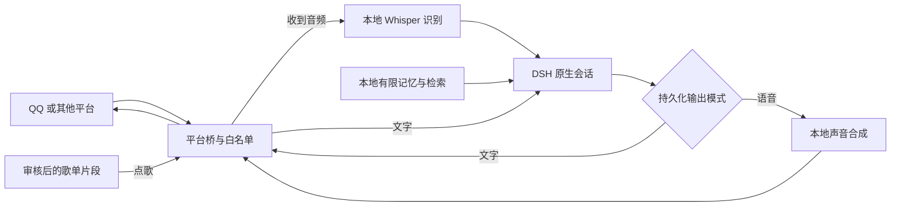

# 总体框架与嫁接原则

## 两种嫁接方法

**已有桥，只加声音**：保留他人的 QQ、B站或其他平台桥，由其调用本地语音接口。它负责平台收发和格式转换；声音包负责识别、合成与音频转换；DSH 负责理解和生成内容。不同桥接口不同，需要实际适配，不能承诺放进去就覆盖所有平台。

**采用独立 QQ 桥**：角色 QQ 登录到 NapCat，通过 OneBot v11 反向 WebSocket 进入桥插件，再进入 DSH 原生 agent/session。声音可接同一套通用服务。独立 QQ 桥不包含 B站账号操作能力；B站需要自己的连接器，上传、评论、账号登录也不是声音接口提供的功能。

## 模块边界

- DSH：模型登录、推理、系统提示词、原生会话与工具。包不提供公共模型账号或通用私人角色规则。
- 平台桥：事件收发、白名单、音频下载、消息合并/队列、文字与语音交付、发送确认。
- 声音服务：参考声音、识别、合成、格式编码，默认只监听本机。情绪提示只影响支持该能力的引擎，不能保证每种参考都能自然笑或生气。
- 记忆：按聊天键隔离，把事件、重要点、会话摘要和轮换记录存本地，给 DSH 提供有上限的相关内容。
- 歌单：只使用安装者审核后的音频。媒体文件能被当前平台进程读取，发送成功后才推进轮换。

## 接口

默认声音前端监听 `127.0.0.1:28133`，后端计算服务默认 `28131`。`setup` 为每位使用者生成新令牌；端口可改，避免与已有服务冲突。

- `POST /v1/audio/transcriptions`：音频转文本。
- `POST /v1/audio/speech`：回复文本转音频。
- `/health`：本机健康状态，需要对应令牌。
- DSH 内通过 `ctx.get('localVoice')` 获取服务，调用 `transcribe`、`synthesize`；返回值包括识别文本或音频 Buffer、格式与分段信息。

请求参数与示例以 `packages/voice/docs/适配现有DSH插件.md`、插件 `src/client.mjs` 和 `src/server.mjs` 为准。已有桥需要实现输入音频下载、当前回复合成、平台音频发送和失败提示；OpenAI 兼容路径只统一协议，不会自动完成平台格式要求。

## QQ 首次接入

1. 安装者准备自己的 DSH、官方 QQ 客户端、角色专用 QQ 和允许聊天的本人 QQ。
2. 按 `packages/qq-bridge/docs/QQ登录与连接.md` 解压原版 NapCat Framework，用角色号扫码登录。
3. 运行安装配置入口，填写自己的两类账号、profile、反向 WS 地址及新生成的 token；默认只允许本人私聊，不开放陌生人和群。
4. 将生成的 OneBot 配置导入自己的 NapCat，保证地址、端口、token 对应。
5. 先验收文字，再启用声音接口。已有相同插件或 profile 配置时先备份再合并，不覆盖安装者原规则。

不自动注册账号，不附赠登录态。出现扫码过期应刷新，角色号与聊天号不要混用。

## 对话行为

语言和输出模式是两个独立开关。明确要求“日语＋语音”后，后续用中文输入也保持日语语音，直到用户明确换中文或文字。切换不能因普通输入语言、一次错误或重启随意丢失。

连续两条消息可能在生成过程中到达。桥要保持同一聊天的串行处理与上下文关联，不能把“你知道吗”等后续句当作无历史的新聊天。合并等待不能保证观察到用户尚未发出的输入；真实平台仍需测试连续发送与慢模型场景。

技术默认包括白名单、持久化偏好、明确错误和受限检索；固定回复长度、私人人设、强制最低推理强度不随公共包分发。
